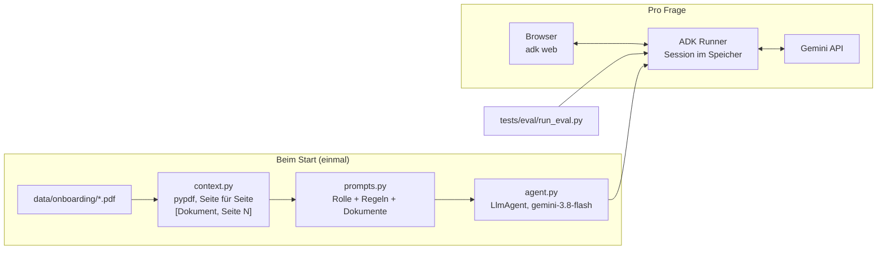

# NetF_Hamburg_HR_bot_demo

KI-Assistent, der neuen Mitarbeitenden organisatorische Fragen beantwortet – ausschließlich auf Basis der Onboarding-Unterlagen, mit Quellenangabe (Dokument, Seite). Erste Version für US1–US3 aus dem [PRD](docs/PRD.md). Alle Daten sind synthetisch (fiktive „Musterfirma GmbH“).

## Quickstart

Voraussetzungen: [uv](https://docs.astral.sh/uv/), `make`, ein Gemini-API-Key aus [Google AI Studio](https://aistudio.google.com/apikey).

```bash
make setup             # Python 3.12 + gepinnte Abhängigkeiten
cp .env.example .env   # danach GOOGLE_API_KEY in .env eintragen
make run               # Chat unter http://127.0.0.1:8000
make test              # Lint + 13 Unit-Tests (ohne API-Key)
make eval              # 10 Fragen gegen das echte Modell (= 10 API-Anfragen)
```

Optional: `GEMINI_MODEL=gemini-3.5-flash-lite` in `.env`, falls das Standardmodell überlastet oder das Free-Tier-Kontingent erschöpft ist.

## Architektur



| Datei | Aufgabe |
| --- | --- |
| `hr_agent/context.py` | Liest alle PDFs, Text pro Seite mit Markierung. Ohne ADK. |
| `hr_agent/prompts.py` | KI-Hinweis, Rolle, 7 Regeln; setzt Regeln und Dokumente zur Instruktion zusammen. Ohne ADK. |
| `hr_agent/agent.py` | Einzige Datei mit ADK: Modell, Retries, Instruktion als Funktion. |
| `scripts/make_sample_pdfs.py` | Erzeugt die vier synthetischen PDFs (`make data`). |
| `tests/test_context.py` | Deterministische Tests: Laden, Seitenzahlen, Markierungen, Instruktion. |
| `tests/eval/` | Verhaltens-Eval: Inhalt, Quelle, Ablehnung, Prompt Injection, Gesundheitsdaten, KI-Hinweis. |

## Entscheidungen

- **Google ADK** statt Pydantic AI oder CrewAI: Web-UI und Sessions inklusive, Tools und Multi-Agent für AS1/AS2 → [ADR 0001](docs/adr/0001-agent-framework.md)
- **Alle Dokumente in der Instruktion** statt RAG: 8 Seiten passen mühelos in den Kontext; RAG erst bei Größe, häufigen Änderungen oder Berechtigungen → [ADR 0002](docs/adr/0002-context-stuffing-vs-rag.md)
- **`gemini-3.8-flash`, exakt gepinnt:** Free Tier nur für die Demo; Produktion mit EU-Endpunkt und AVV → [ADR 0003](docs/adr/0003-model-and-data-residency.md)
- **Instruktion als Funktion:** ADK würde `{…}` in einer String-Instruktion als Platzhalter ersetzen und bei unbekannten Namen abbrechen.
- **Sessions nur im Speicher:** `adk web` würde Gespräche sonst unter `hr_agent/.adk/` speichern.
- **Eval mit einfachen String-Regeln** statt LLM-as-Judge: transparent und kostenlos. 10 Fälle sind ein Smoke-Test, kein Qualitätsbeweis.

## Datenschutz

Nur synthetische Daten. Einordnung nach EU AI Act und DSGVO sowie Schritte vor einem Produktivbetrieb: [docs/compliance.md](docs/compliance.md).

## Roadmap

Nächster Schritt: [AS1 – anonymes Themen-Log](docs/stories/AS1-topic-logging.md). Danach Experten-Agenten, RAG, eigenes UI und Betrieb in der EU: [docs/roadmap.md](docs/roadmap.md).
